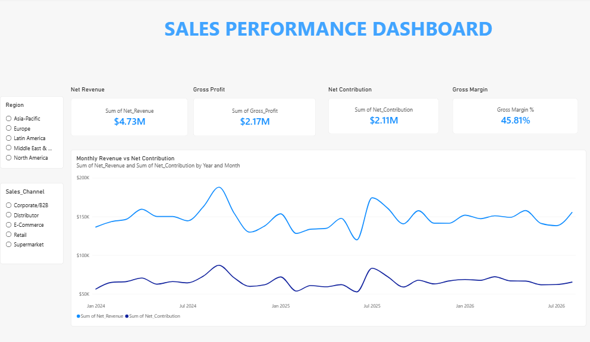
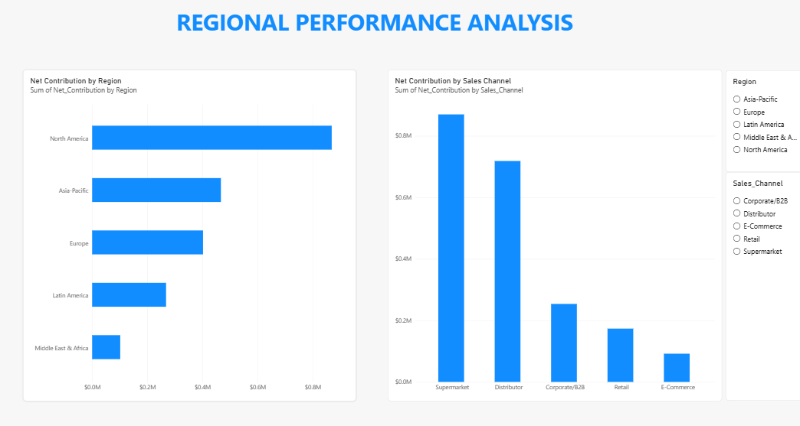
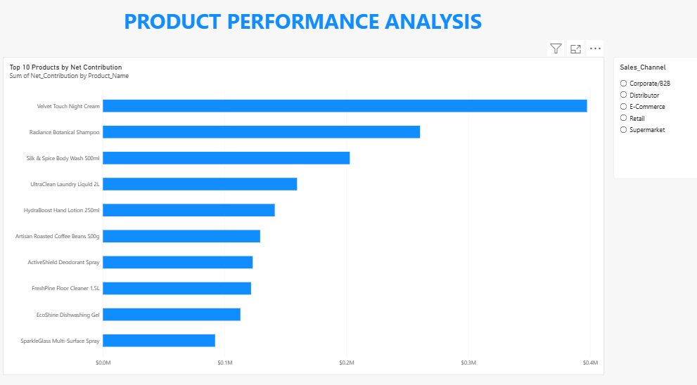

# AURELIA
### Consumer Products | Business Performance & Profitability Analysis

**End-to-End Data Analytics & Business Intelligence Project**

  
  
  
  

---

## PROJECT SHOWCASE

Aurelia is an end-to-end business analytics project in which I examined consumer product performance, profitability and regional business results. I worked across Excel, SQL Server and Power BI to transform business data into structured analysis, interactive dashboards and management-oriented insights.

The following dashboards present three perspectives of the analysis.

### 1. Executive Business Overview

  

<i>Consolidated view of business performance and key indicators.</i>

### 2. Regional Performance

  

<i>Geographical analysis of business performance across regions.</i>

### 3. Product Performance

  

<i>Product-level performance and profitability analysis.</i>

---

## 01. PROJECT OVERVIEW

I developed Aurelia as a comprehensive business performance and profitability analysis project, using a consumer products dataset to investigate how different aspects of a business contribute to its overall financial performance.

My approach was to treat the dataset as a business intelligence problem rather than simply a data manipulation exercise.

I wanted to understand the relationships between sales, revenue, costs and profitability, examine performance across products and geographical regions, and establish what the data could reveal about the business.

I carried out the analysis through three principal stages:

- **Excel:** Data preparation, quality assessment and exploratory analysis.
- **SQL Server:** Structured data investigation, financial calculations and business performance analysis.
- **Power BI:** Data modelling, analytical visualisation and interactive business intelligence dashboards.

I also produced supporting analytical reports documenting the Excel and SQL work, findings and business implications.

## 02. BUSINESS OBJECTIVES

The project was designed to answer practical business questions and provide a clearer understanding of organisational performance.

My primary objectives were to:

1. Evaluate revenue and profitability across products and geographical regions.
2. Identify the major contributors to business performance.
3. Examine the relationship between sales, costs and profit.
4. Investigate differences in performance across business dimensions.
5. Identify potential areas of underperformance and opportunities for improvement.
6. Translate analytical findings into insights that can support management decisions.

## 03. BUSINESS QUESTIONS

I structured the investigation around the following questions:

- How is revenue distributed across products and regions?
- Which products contribute most significantly to overall profitability?
- Which geographical regions demonstrate stronger or weaker performance?
- How do sales, costs and profit relate to one another?
- What differences emerge when business performance is examined across multiple dimensions?
- Where should management direct attention to improve profitability and operational performance?

These questions informed the data preparation, SQL investigation and dashboard development.

## 04. TECHNOLOGY STACK

| Technology | Technical Application |
|---|---|
| Microsoft Excel | Data cleaning, quality assessment, transformation and exploratory analysis |
| Microsoft SQL Server | Relational data querying, analytical calculations and structured business investigation |
| SQL | Data extraction, aggregation, conditional logic and performance analysis |
| Microsoft Power BI | Data modelling, DAX, interactive dashboards and business intelligence |

## 05. ANALYTICAL METHODOLOGY

### A. Data Preparation & Quality Assessment

**Microsoft Excel**

I began by examining the dataset, assessing its structure and preparing it for reliable analysis.

My work included:

- Dataset inspection and structural assessment.
- Missing-value and duplicate checks.
- Data consistency and quality validation.
- Cleaning and organisation of the dataset.
- Exploratory analysis to understand the underlying business variables.
- Preparation of the analytical dataset for SQL investigation.

The emphasis was on data reliability and establishing a consistent analytical foundation.

### B. SQL Development & Business Analysis

**Microsoft SQL Server**

I used SQL Server to conduct structured investigations of the business dataset.

I developed analytical queries to examine business performance, calculate relevant measures and investigate relationships across products, regions and other business dimensions.

The SQL work covered:

- Data exploration and validation.
- Aggregations and grouped analysis.
- Revenue and profitability calculations.
- Product-level performance analysis.
- Regional performance analysis.
- Comparative business analysis.
- Identification of patterns and performance differences.

The completed SQL script and accompanying analytical report are included in this repository.

### C. Data Modelling & Business Intelligence

**Microsoft Power BI**

I developed interactive Power BI dashboards to communicate the analytical results and provide different perspectives on business performance.

The dashboard work involved:

- Preparing and structuring data for reporting.
- Establishing analytical relationships.
- Developing measures using DAX.
- Designing KPI and performance visualisations.
- Creating interactive reporting views.
- Presenting business performance across executive, regional and product dimensions.

The dashboards provide a more accessible way to examine performance, compare business dimensions and interpret the underlying data.

### D. Analytical Reporting & Interpretation

I consolidated the analytical work into separate Excel and SQL business performance reports.

Beyond documenting the technical process, I focused on interpreting the results, explaining their business significance and presenting observations that could inform management action.

## 06. ANALYTICAL DIMENSIONS

The investigation covered several interconnected aspects of business performance.

| Dimension | Business Focus |
|---|---|
| Revenue Performance | Revenue contribution and distribution |
| Profitability | Profit generation and financial performance |
| Product Performance | Product-level contribution and comparison |
| Regional Performance | Geographical performance differences |
| Cost Analysis | Cost relationships and their impact on profitability |
| Comparative Analysis | Identifying variations across business dimensions |
| Management Reporting | Communicating performance through KPIs and visual analysis |

## 07. BUSINESS INTELLIGENCE & DECISION SUPPORT

An important part of my approach was connecting technical analysis to business utility.

The resulting analysis and dashboards provide management with a structured view of:

**Performance visibility**

Understanding how the business performs across products and regions, rather than relying on isolated financial figures.

**Profitability assessment**

Examining the contribution of products and other business dimensions to overall financial performance.

**Performance comparison**

Identifying differences between business segments and areas that may require further investigation.

**Management attention**

Highlighting performance patterns that can guide further investigation, resource allocation and business improvement decisions.

**Evidence-based planning**

Providing structured analytical information that supports more informed commercial and operational decisions.

## 08. PROJECT DELIVERABLES

The repository contains the working dataset, analytical scripts, reports and visual evidence produced during the project.

| Deliverable | Description |
|---|---|
| Consumer Products Profitability Dataset | Source dataset used for the analysis |
| Aurelia SQL Query File | Completed SQL analysis script |
| Excel Business Performance Report | Documentation of Excel-based analysis and findings |
| SQL Business Performance Report | Documentation of SQL analysis and findings |
| Power BI Dashboards | Interactive business intelligence reporting |
| Dashboard Screenshots | Visual representation of the analytical outputs |

### Repository Files

- `Aurelia_Consumer_Products_Profitability_Dataset 1.xlsx`
- `AureliaSQLQuery.sql`
- `Aurelia_Excel_Business_Performance_Report.docx`
- `Aurelia_SQL_Business_Performance_Report.docx`
- `Screenshot (33).png`
- `Screenshot (34).png`
- `Screenshot (35).png`

## 09. TECHNICAL & PROFESSIONAL CAPABILITIES

Through this project, I demonstrated the application of:

**Data Analytics**
- Data preparation and quality assessment.
- Exploratory data analysis.
- Data transformation and validation.
- Financial and profitability analysis.
- Comparative and performance analysis.

**Database & SQL**
- SQL Server.
- Structured querying.
- Aggregations and calculations.
- Business-oriented data investigation.
- Analytical query development.

**Business Intelligence**
- Power BI.
- Data modelling.
- DAX measures.
- KPI development.
- Interactive dashboard design.
- Performance reporting.

**Business Analysis**
- Business problem definition.
- Performance interpretation.
- Analytical reasoning.
- Identifying performance gaps.
- Translating findings into management insights.

## 10. PROJECT OUTCOME

Aurelia brought together data preparation, database analysis, business intelligence and analytical reporting into one integrated project.

I completed the analytical workflow from initial dataset assessment through Excel preparation and SQL investigation to Power BI dashboard development and business reporting.

The result is a documented analytical solution that demonstrates how I approach business data: understanding the problem, establishing reliable data, investigating performance, interpreting findings and communicating information in a form that supports decisions.

For me, the value of this work is not simply the ability to use Excel, SQL or Power BI independently. It is the ability to connect these tools within a coherent analytical process and apply them to questions that matter to a business.

---

## ABOUT THE AUTHOR

**Prosper Nwaiwu**

**Data Analyst | Business Intelligence & Systems Architecture**

I work at the intersection of data analytics, business intelligence and operational strategy.

My focus is on understanding how organisations operate, examining the information behind their performance, identifying opportunities and translating analytical findings into practical business intelligence.

I am particularly interested in the use of data, technology and structured problem-solving to improve organisational performance and decision-making.

**Connect with me**

- [GitHub Profile](https://github.com/prospernwaiwu)
- [LinkedIn](https://www.linkedin.com/in/prosper-nwaiwu/)

---

  <b>DATA → ANALYSIS → INTELLIGENCE → ACTION</b>
   
  AURELIA | BUSINESS PERFORMANCE & PROFITABILITY ANALYSIS

